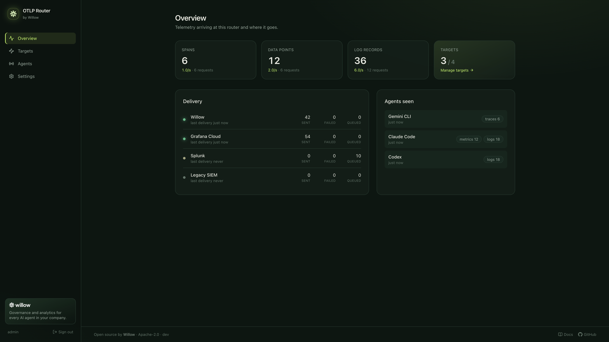
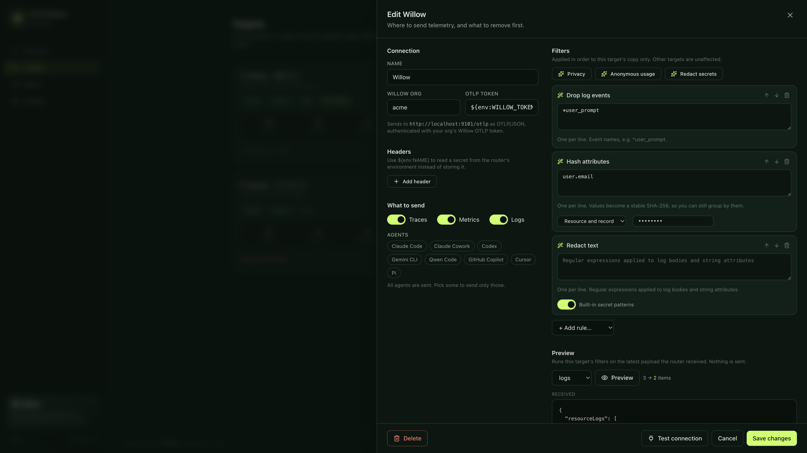

<p align="center">
  
</p>

<h1 align="center">OTLP Router</h1>

<p align="center">
  One OpenTelemetry endpoint for your AI agents. Every destination, filtered your way.<br />
  Open source by <a href="https://withwillow.ai">Willow</a>.
</p>

<p align="center">
  <a href="https://github.com/webrix-ai/otlp-router/actions/workflows/ci.yml"></a>
  <a href="LICENSE"></a>
</p>



Claude Code, Codex, Gemini CLI, GitHub Copilot and the agent SDKs all export OpenTelemetry. Each can send to one place.
OTLP Router is that place: point every agent at it, and it copies each payload to as many destinations as you
configure, such as Datadog, Grafana, Splunk, your own collector or Willow. Before sending, it removes what that
destination must not see.

- **One ingress.** OTLP over gRPC (`:4317`) and HTTP (`:4318`), protobuf or JSON, gzip, for traces, metrics and logs.
- **Many targets.** Each target gets its own copy, its own filters and its own retry queue, so a slow or failing
  vendor never holds up the others.
- **Per-target filters.** Drop prompt events, drop, mask or hash attributes such as `user.email`, redact API keys and
  tokens, drop spans or metrics by name, and choose which agents a target receives.
- **A web UI.** Turn targets on and off, edit filters, and preview exactly what a target will receive using the latest
  real payload. Protected by an admin login set in the config.
- **Ingest tokens.** Agents authenticate with bearer tokens you create, rotate and revoke in the UI. Only hashes are
  stored.
- **Agent aware.** Recognises Claude Code, Codex, Gemini CLI, Qwen Code and GitHub Copilot from `service.name`, and
  gives copy-paste setup for each.
- **Kubernetes first.** A Helm chart; targets edited in the UI are stored in a ConfigMap shared by all replicas.

## Install

```bash
helm install otlp-router oci://ghcr.io/webrix-ai/charts/otlp-router \
  --namespace observability --create-namespace
```

Open the UI and sign in as `admin`:

```bash
kubectl -n observability port-forward svc/otlp-router 8080
kubectl -n observability get secret otlp-router -o jsonpath='{.data.admin-password}' | base64 -d; echo
```

Then create an ingest token on the **Tokens** page. Until one exists, the router rejects all telemetry.

To send to Willow as well:

```bash
helm upgrade --install otlp-router oci://ghcr.io/webrix-ai/charts/otlp-router -n observability \
  --set willow.enabled=true --set willow.org=acme --set willow.token="$WILLOW_OTLP_TOKEN"
```

If your Willow org is in the EU region (`acme.eu.withwillow.ai`), add `--set willow.region=eu`. For on-prem Willow or
a custom domain, use `--set willow.region=custom --set willow.connectUrl=https://willow.acme.internal` instead of
`willow.org`.

Everything the chart accepts is documented in [`charts/otlp-router/values.yaml`](charts/otlp-router/values.yaml).

### Docker

```bash
docker run -p 4317:4317 -p 4318:4318 -p 8080:8080 \
  -e OTLP_ROUTER_ADMIN_PASSWORD=change-me \
  -v "$PWD/config.yaml:/etc/otlp-router/config.yaml:ro" -v otlp-router:/data \
  ghcr.io/webrix-ai/otlp-router
```

Use [`config.example.yaml`](config.example.yaml) as a starting point; it uses the `file` store at `/data`.

## Connect your agents

The UI's **Agents** page shows these with your ingress URL filled in, and with the token you just created. Replace
`change-me` below with an ingest token.

**Claude Code** (shell profile, or the `env` block of `managed-settings.json`):

```bash
export CLAUDE_CODE_ENABLE_TELEMETRY=1
export OTEL_METRICS_EXPORTER=otlp OTEL_LOGS_EXPORTER=otlp
export OTEL_EXPORTER_OTLP_PROTOCOL=http/protobuf
export OTEL_EXPORTER_OTLP_ENDPOINT=https://otel.acme.internal
export OTEL_EXPORTER_OTLP_HEADERS="Authorization=Bearer change-me"
```

**Codex** (`~/.codex/config.toml`):

```toml
[otel]
log_user_prompt = false
exporter = { otlp-http = { endpoint = "https://otel.acme.internal/v1/logs", protocol = "binary", headers = { "Authorization" = "Bearer change-me" } } }
```

**Gemini CLI** (`~/.gemini/settings.json`), plus `OTEL_EXPORTER_OTLP_HEADERS` for the token:

```json
{ "telemetry": { "enabled": true, "target": "local", "otlpEndpoint": "https://otel.acme.internal", "otlpProtocol": "http" } }
```

**Anything else** that exports with an OpenTelemetry SDK (the Claude Agent SDK, your own agents) reads the standard
`OTEL_EXPORTER_OTLP_ENDPOINT` and `OTEL_EXPORTER_OTLP_HEADERS` variables.

Only agents with their own official OpenTelemetry export are listed here.

## Ingest tokens

Agents send `Authorization: Bearer <token>`, over HTTP or as gRPC metadata. Manage tokens on the UI's **Tokens** page:

- **Create.** Name a token after the agents that use it, such as "Engineering laptops" or "CI". The token (`otr_…`) is
  shown once. The router stores only its SHA-256 hash, in the same store as the targets, so every replica accepts it
  within seconds.
- **Rotate.** Issues a new token with the same name. The old one keeps working for the grace period you pick (none,
  1 hour, 24 hours or 7 days) while you roll the new one out, then stops.
- **Revoke.** Stops a token immediately.

The page shows when each token was last used (as seen by the replica serving the page), and `/metrics` counts rejected requests in
`otlp_router_ingest_unauthorized_total`, so you can see when the old token has gone quiet.

Tokens in `auth.ingestTokens` (Helm: `auth.ingestTokens` or the `ingest-tokens` key of `auth.existingSecret`) are
accepted as well, for setups that keep tokens in a secret manager. Rotate those in the config. `readOnly: true` turns
off token changes in the UI too.

## Targets and filters



| Type       | Sends                                                                              |
| ---------- | ---------------------------------------------------------------------------------- |
| `otlphttp` | OTLP/HTTP to `<endpoint>/v1/<signal>`, protobuf or JSON                            |
| `otlpgrpc` | OTLP/gRPC to `host:port` (`http://` for plaintext)                                 |
| `willow`   | OTLP/JSON to your Willow org, passing through `X-Device-Id` and `X-User-Email`     |

Filters run in order, on that target's copy only:

| Rule              | Does                                                                            |
| ----------------- | ------------------------------------------------------------------------------- |
| `drop_log_events` | Drops log records whose event name matches, e.g. `*user_prompt`                 |
| `drop_attributes` | Removes attributes by key glob, on resources, records or both                   |
| `mask_attributes` | Replaces values with `[REDACTED]`                                               |
| `hash_attributes` | Replaces values with a salted SHA-256, so you can still group by them           |
| `redact`          | Regex replace in log bodies and string attributes; `builtins` covers common keys |
| `drop_spans`      | Drops spans by name                                                             |
| `drop_metrics`    | Drops metrics by name                                                           |

The UI ships presets: **Privacy** (drop prompts and content, hash identity, redact secrets), **Anonymous usage** and
**Redact secrets**.

Header values, tokens and salts can be `${env:NAME}` references. They are resolved inside the router, so the secret
lives in a Kubernetes Secret or environment variable and never in the stored target list. Literal secrets entered in
the UI are stored as typed and shown masked.

## Configuration

The config file (Helm renders it for you) holds what the operator owns: listeners, the admin login, any ingest tokens
managed outside the UI, the store, and the targets to seed on first start. See [`config.example.yaml`](config.example.yaml).

| Store       | Use                                                                                   |
| ----------- | ------------------------------------------------------------------------------------- |
| `configmap` | Kubernetes. Every replica polls the ConfigMap, so edits apply everywhere in seconds.  |
| `file`      | Docker or a VM, with a volume.                                                        |
| `memory`    | Development. Targets reset on restart.                                                |

Set `readOnly: true` to manage targets and tokens only through config (GitOps). The UI then shows them but cannot
change them.

## Security

- The UI and API need the admin login. Sessions are HTTP-only, `SameSite=Strict` cookies signed with
  `auth.sessionSecret`; failed logins are rate limited.
- Ingest always requires a token unless `auth.allowUnauthenticatedIngest` is on. With no tokens, everything is
  rejected rather than accepted, so revoking the last token never opens the router up.
- Expose the UI only on an internal network. The chart has separate ingresses for OTLP and the UI.
- The router keeps the last few payloads per signal in memory for the filter preview. They can contain prompts, are
  shown only to the admin, and are never written to disk.
- `/metrics` (Prometheus) is unauthenticated and exposes counters and target ids only.

## Development

```bash
make ui        # build the UI into web/dist (embedded in the binary)
make run       # router on :4317/:4318/:8080, log in with admin / admin
make dev       # UI with hot reload on :5173
make sample    # send sample Claude Code, Codex and Gemini CLI telemetry, with ingest token dev-token
make test lint chart-lint
```

## License

Apache-2.0. Built and maintained by [Willow](https://withwillow.ai), governance and analytics for every AI agent in
your company.
